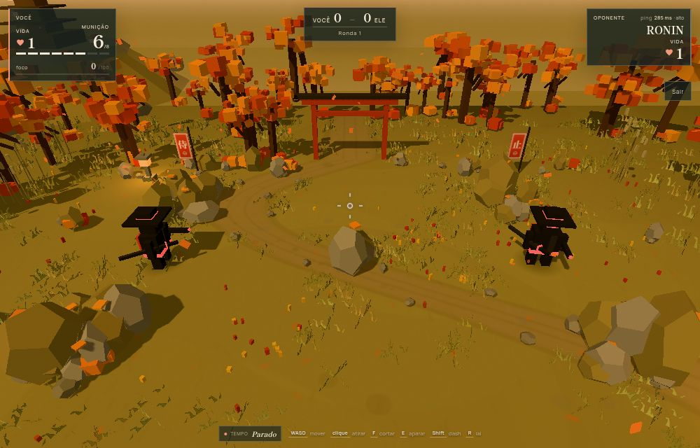
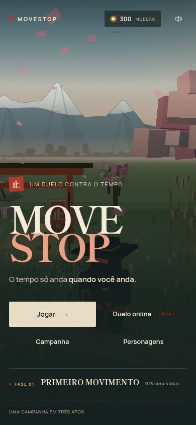

# MOVESTOP

[](LICENSE)
[](https://github.com/luis-ota/movestop/actions/workflows/deploy.yml)
[](https://bun.sh)
[](https://threejs.org)

Shooter voxel de samurai em que o tempo só anda quando você anda. Vite + Three.js; a campanha é 100% estática (save em `localStorage`, checkout de demonstração) e o duelo online usa um servidor Bun autoritativo.

## Sobre

MOVESTOP é para quem gosta de ação com precisão, estética voxel e desafios de domínio do tempo. O jogo tem uma campanha de oito fases e um duelo 1v1 online com servidor autoritativo, matchmaking, salas privadas, rounds e controles de toque.

Stack principal: **TypeScript**, **Three.js**, **Bun**, **Vite** e **Playwright** para verificação manual/E2E. O repositório inclui 65 testes automatizados do protocolo, combate, rounds, snapshots, abuso e política de proxy.

<p align="center">
  
  
</p>

## Produção

**https://movestop.wired.rs** — build servido pelo Bun, duelo online via `/ws`; deploy automático pelo GitHub Actions no instabox e Coolify. Detalhes em `docs/DEPLOY.md`.

## Rodar

```bash
bun install
bun run dev      # http://localhost:5173
bun run build
bun run typecheck:server
bun run preview
```

## Controles — desktop

| Ação | Tecla |
| --- | --- |
| Mover (e fazer o tempo andar) | `WASD` / setas |
| Mirar | mouse |
| Atirar | clique esquerdo / `Espaço` |
| Cortar (combo de 3, reflete balas) | `F` |
| Aparar / contra-golpe | clique direito / `E` / `Q` |
| Dash | `Shift` |
| Iai (golpe especial, foco cheio) | `R` |

**Foco** enche com abates, cortes e aparos. Com 100, o botão `Iai` acende. O Iai avança em linha, corta tudo no caminho e desacelera o mundo por meio segundo.

## Controles — celular

Os controles aparecem só durante a partida, nos cantos, com fundo translúcido:

- **Joystick esquerdo**: mover. O tempo anda enquanto você se move.
- **Arraste na metade direita**: mirar e atirar. Um toque dispara uma bala; segurar mantém o fogo. O anel aparece onde o dedo toca.
- **Cortar**: combo de katana.
- **Aparo**: reflete balas; dois ou mais reflexos disparam um contra-golpe.
- **Dash**.
- **Iai**: acende quando o foco está cheio.

O HUD no celular mantém munição, vida, objetivo e tempo; radar e dicas de teclado ficam ocultos para não cobrir o campo. O briefing mostra a versão de toque dos controles.

## Dificuldade

A campanha tem três modos, escolhidos no briefing antes de entrar:

- **Fácil:** mais vida e munição; inimigos mais lentos e menos frequentes.
- **Difícil:** padrão recomendado; inimigos mais rápidos e agressivos. Escudos levam dois tiros ou um corte.
- **Impossível:** inimigos resistentes, implacáveis e com menos munição.

A escolha fica salva localmente e vale para a campanha. O duelo online continua com regras competitivas fixas.

## Duelo online

O modo online é um **duelo 1v1 autoritativo**. O servidor em `server/` guarda a arena, a simulação, a vida, munição, dano, aparo, foco, rounds e o vencedor; o cliente só envia intenções de movimento, mira e ações. Não há posição, hit ou resultado decidido no navegador.

```bash
bun run server     # HTTP + WebSocket em http://localhost:8788
bun run dev        # Vite em :5173; /ws é proxiado para :8788
```

- **Partida rápida** entra na fila pública.
- **Criar sala** abre uma sala privada com código de 6 caracteres; o oponente entra com o código.
- **Sair** no HUD pede confirmação em dois toques; a saída dá vitória ao oponente.
- **Revanche** volta para a fila e cria uma nova sala; não preserva a dupla nem o placar anterior.
- O servidor valida Origin, limita conexões/IP, tamanho de mensagem, taxa e sequência; cooldowns, munição, foco e acertos são todos checados no servidor.
- Em produção, use TLS (`wss://`) atrás de um proxy, `ALLOWED_ORIGINS`, `NODE_ENV=production` e o `Dockerfile`. Veja `docs/ONLINE.md`.
- **Limitações honestas:** salas são efêmeras e em memória; não há contas, ranking, reconexão, espectadores ou chat. Wallhack/aimbot não são totalmente detectáveis. **Compras reais não são server-side neste protótipo** — o checkout é uma demonstração local e, em produção, precisa de webhook assinado + entitlement no servidor. O servidor de duelo não processa pagamentos.

## Estrutura

- `src/game/game.ts` — engine, câmera, combate, IA, ondas, chefe.
- `src/game/levels.ts` — oito fases e expansão do campo aberto.
- `src/game/landscape.ts` — vale, rio, ponte, templo, árvores, clima.
- `src/game/backdrop.ts` — panorama pintado das montanhas, sol/lua e floresta distante.
- `src/game/voxel.ts` — avatares, haori, lâmina, sombras.
- `src/ui/ui.ts` / `src/style.css` — menu, HUD, loja, personagens e controles de toque.
- `src/ui/online.ts` / `src/online.css` — lobby, fila, HUD e resultado do duelo.
- `src/multiplayer/` — transporte WebSocket e adaptador de input.
- `server/` — servidor autoritativo, salas, validação e hardening.
- `tests/` — 65 testes do protocolo, rounds, combate, snapshots, abuso e IP de proxy.

## Open source

MOVESTOP is released under the [MIT License](LICENSE). The project is currently created and maintained by [@luis-ota](https://github.com/luis-ota); a friend may help later, but no one else currently owns part of it.

- [Contributing guide](CONTRIBUTING.md)
- [Roadmap board](https://github.com/users/luis-ota/projects/1)
- [Roadmap](ROADMAP.md)
- [Code of Conduct](CODE_OF_CONDUCT.md)
- [Security policy](SECURITY.md)
- [Maintainers](MAINTAINERS.md)
- [Third-party notices](THIRD_PARTY_NOTICES.md)

Issues and pull requests are welcome. There is no CLA at this time.

## Monetização

`docs/BUSINESS.md` reúne a pesquisa. No protótipo, o checkout é explicitamente uma demonstração local; em produção, troque `purchasePack()` por um checkout hospedado e valide a compra por webhook. Nada é pay-to-win.
